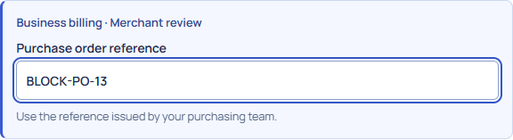

# B2B Purchase Order Gateway

An original CodexaWP offline payment-method demo. Approved business accounts can enter a purchase order reference and create an on-hold WooCommerce order for merchant review.

## Try it

Enable **Purchase Order** under WooCommerce payment settings. For a test customer, set the user meta key `_codexawp_po_approved` to `yes` using your test site's management tools. The reference accepts 3–40 letters, digits, hyphens or slashes. Test both the Classic Checkout shortcode and the Checkout block.

## Verification

Activate this plugin on a disposable WordPress site with WooCommerce active and `WP_ENVIRONMENT_TYPE` set to `local`. Set `CODEXAWP_TEST_WP_LOAD` to the absolute path to that site's `wp-load.php`, then run `php tests/check.php` from this repository.

The PHP fixture checks qualification, reference format, review status and the saved reference. Test orders were also submitted in both checkout interfaces. See the [classic checkout field](docs/checkout-classic.png) and [block checkout field](docs/checkout-block.png).

## License

GPL-2.0-or-later. See [LICENSE](LICENSE).
